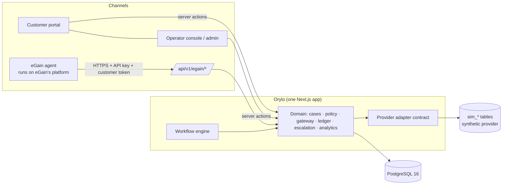
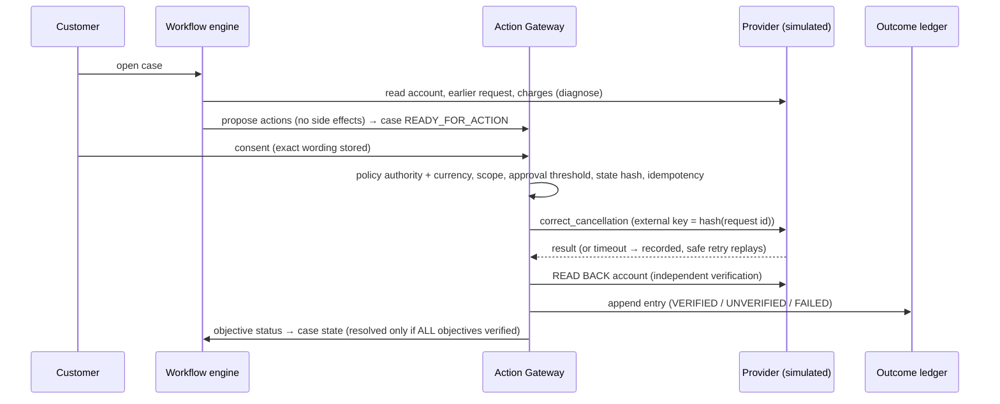

# Architecture overview

Status: describes the code in this repository as built. Diagrams are Mermaid.

## Shape: a modular monolith
One Next.js 16 application (App Router, React 19, TypeScript) over one PostgreSQL 16 database. No broker, no
microservices, no workflow framework, no paid services. Domain logic lives in `src/domain` and `src/workflows` and
has **no dependency on React or Next** (apart from `src/auth/session.ts` and `src/app/**`), so it is tested directly
against a real database.

## Core flow (Failed Cancellation & Billing Recovery)

## Key design decisions (ADRs)
| # | Decision | Why | Trade-off |
|---|---|---|---|
| 1 | Single Next.js app at repo root instead of `apps/*` + `packages/*` | Fewer moving parts, one build, direct imports; boundaries are folders (`src/domain` etc.) | A monorepo split can be done later; today nothing enforces the boundary except convention |
| 2 | Drizzle ORM + `pg` | SQL-first, typed, small, migrations are plain SQL (needed for triggers) | Less abstraction than Prisma; hand-written SQL for aggregates |
| 3 | Better Auth for authentication | Established library: scrypt hashing, signed httpOnly cookies, built-in rate limits, reset flow | Email verification/reset delivery needs a provider (none configured) |
| 4 | **Tenant isolation in three layers**: every domain call takes `Ctx{orgId}` and filters on it; composite FKs `(id, organization_id)` make cross-tenant links impossible in the DB; negative tests per surface | A missing `WHERE` in app code must not become a data leak | Verbose queries; `audit_events` (nullable org) is the only table without the composite pattern |
| 5 | **Append-only evidence via triggers** (`case_events`, `audit_events`, `outcome_ledger`) and a trigger that refuses `VERIFIED_RESOLVED` without a `VERIFIED` ledger row and verified required objectives | Application bugs must not be able to fabricate "resolved" | A superuser can still disable triggers; ledger hash-chain makes edits detectable, not impossible |
| 6 | Policy **text is data**, authorization reads structured `rules` from APPROVED, effective versions; instruction-like text is quarantined | Structural defence against prompt-injection via knowledge | Rules must be maintained next to prose (enforced by review, not by tooling) |
| 7 | Idempotency by `unique(org, idempotency_key)` + row locks (case → request order) + a **provider-side** idempotency key derived from the request id | Exactly-once effect under concurrent duplicates and timeouts | The gateway holds a DB transaction across the provider call (acceptable for the simulator; a real network provider would need a lease/outbox) |
| 8 | Read-after-write verification is part of the action, not an afterthought | "API said OK" ≠ outcome | Doubles provider reads |
| 9 | Server actions for UI mutations, bearer-key REST only for the eGain channel | Server actions get Next's origin checks; no CSRF surface on bearer APIs | Server actions are public POST endpoints — every one re-derives identity and permissions server-side |
| 10 | Workflow engine interprets a validated JSON spec; it orchestrates but never authorizes | Authoring stays safe (no code execution); authority is always the gateway + policy | Limited node vocabulary by design (not BPMN) |
| 11 | Polling (`AutoRefresh`) instead of realtime | No realtime infra; no unsupported claims | 15–20 s staleness |
| 12 | Postgres-backed rate limiter | Works across instances without Redis | Not tuned; contention under heavy load |

## Data model (50 tables; see `src/db/schema.ts`)
Identity (4, Better Auth) · tenancy (organizations, memberships, invitations, api_keys, queues) · customers & access grants ·
policy (documents, versions, approvals, knowledge_gaps) · workflows (definitions, versions, executions, step executions) ·
cases (resolution_cases, case_objectives, case_events, case_evidence, assignments) · actions (requests, approvals, attempts,
receipts) · outcome_ledger · escalations · notifications · integrations (connections, events) · audit_events · commercial (plans,
subscriptions, invoices, usage_records) · evaluation_runs, test_fixtures · leads, rate_limits · synthetic provider (`sim_*`, 5).
`evaluation_runs`, `test_fixtures` and `integration_events` exist in the schema but **no code writes them yet**.

## Case state machine
14 states (`src/domain/case-machine.ts`). Transitions are a table keyed by (from, to) listing which actor kinds
(customer / operator / system) may perform them; anything not listed is illegal. A full chart is generated in
`docs/product/user-journeys.md`. `VERIFIED_RESOLVED` is reachable only by `system` from `OUTCOME_PENDING_VERIFICATION`.

## Concurrency model
- `transitionCase` / `appendEvent` / gateway calls take `SELECT … FOR UPDATE` on the case row first, then the action request
  (single lock order → no deadlocks). Event sequence numbers are gap-free per case.
- Org-wide ledger appends take an advisory lock so the hash chain stays linear.
- Concurrent duplicate confirms: all callers serialize on the request row; the first executes, the rest return the stored receipt.

## What is deliberately NOT here
Real provider connectors · email delivery · SSO/MFA · object storage · realtime push · multi-region · background job runner
(timeouts are swept on demand via `sweepTimeouts`; there is no scheduler) · a no-code integration builder.
