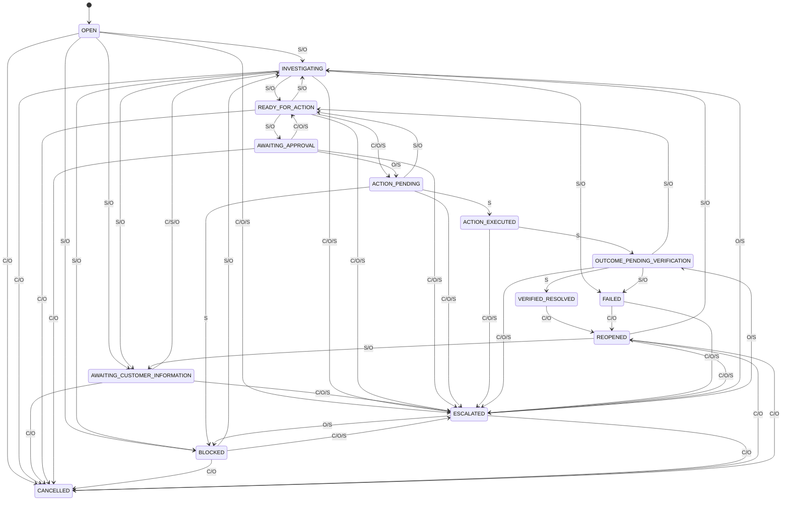

# User journeys

**Status / what this describes:** The ten critical customer journeys and four operator journeys as the built product behaves on 2026-11-10, with the real case-state names and the test that covers each. Written from the code (`src/app`, `src/components`, `src/domain`, `src/workflows`) and the tests (`tests/e2e`, `tests/integration`, `tests/unit`). No user has tried these journeys; every journey is `Hypothesis (unvalidated)` as an experience. Data is synthetic: Jordan Reyes ($29.99 charge), Priya Nair ($149.00 charge, needs approval), Marcus Bell (already cancelled, review only), Elena Rossi (no earlier cancellation, goes to a person). "Orylo" is an uncleared working name.

Test files: `journey.spec.ts`, `a11y-responsive.spec.ts`, `egain-api.spec.ts`, `auth.spec.ts` are Playwright (browser or HTTP) in `tests/e2e/`. `recovery-flow`, `gateway-safety`, `workflows-and-modules`, `policy-and-isolation`, `search-and-analytics` are Vitest against a real database in `tests/integration/`. `case-machine.test.ts` is in `tests/unit/`. `review-findings.test.ts` (security review fixes) is in `tests/security/`.

## Customer journeys

### 1. A new customer reports a failed cancellation

- **Sees and does:** Signs in, chooses "Start a case", leaves "I cancelled, but I was charged again" selected, optionally enters the account number (the form lists the accounts it found), presses "Open my case". Lands on `/portal/cases/ORY-n`. Sees "What we know" (plan, earlier cancellation "Found — received <date>", the charge), "What we don't know", "0 of 3 verified", and two decision cards.
- **System:** Case created as `OPEN`; the engine runs diagnosis (`INVESTIGATING`), then proposes two actions (`READY_FOR_ACTION`). If no earlier request is found (Elena), the engine escalates and the case becomes `ESCALATED`.
- **Verified:** `journey.spec.ts`, "customer: finds the facts, consents, sees verified vs pending…" (failed-cancellation path). Elena's escalation: `workflows-and-modules.test.ts`, "Scenario E". Via eGain: `egain-api.spec.ts`, "verified session resumes…".

### 2. A returning customer resumes an existing case

- **Sees and does:** Opens `/portal`; "In progress" lists open cases with a progress bar ("1 of 3 outcomes verified") and "Open case". `/portal/cases` lists all cases. An open case page refreshes itself every 20 seconds.
- **System:** No state change; one server projection feeds the page. Through eGain, `POST /sessions` returns the existing open case (`ORY-1001` in the test). In the portal, "Start a case" always creates a new case; it does not offer the open one.
- **Verified:** eGain resume: `egain-api.spec.ts`. Opening a case from the list: last test of `journey.spec.ts`. The dashboard list and the self-refresh: `Not covered by an automated browser test` (the dashboard is only scanned by axe).

### 3. A customer authorizes a permitted correction

- **Sees and does:** The region "Apply your earlier cancellation" shows the exact wording ("I confirm I asked to cancel account NF-100234 …"). Presses "Yes, go ahead". Sees "1 of 3 verified", the Verified seal, "Verified by read-back", and a receipt number.
- **System:** Consent stored with the wording. `READY_FOR_ACTION` → `ACTION_PENDING` → `ACTION_EXECUTED` → `OUTCOME_PENDING_VERIFICATION`. A confirmation is valid for 72 hours. The provider is read back; the objective becomes `VERIFIED`; because another step is waiting, the case returns to `READY_FOR_ACTION`. For a charge over the threshold (Priya, $149.00) the review waits in `AWAITING_APPROVAL`; after a team member approves, the card returns to the customer and the customer confirms again to run it.
- **Verified:** `journey.spec.ts` (Jordan). Over-threshold wait: `egain-api.spec.ts` and `recovery-flow.test.ts`, "approval threshold". The approve click and the second customer confirmation in a browser: `Not covered by an automated browser test`.

### 4. A customer declines

- **Sees and does:** Presses "No, don't do this". Sees "Okay — nothing was changed. You can still ask for a person."
- **System:** A declined consent is stored; the request becomes `DENIED` (`CUSTOMER_DECLINED`); the case stays `READY_FOR_ACTION`; the account is untouched. A recorded answer is final: answering again the other way is refused with "You've already answered this step. To change your mind, ask for a person." A declined request cannot be re-proposed from the portal.
- **Verified:** `recovery-flow.test.ts`, "customer declines (journey 4)"; finality in `review-findings.test.ts` (F13). `Not covered by an automated browser test`.

### 5. A customer provides missing evidence

- **Sees and does:** In the missed-appointment or warranty workflow the case shows "We need a few details" with only the missing fields (date, windows one per line, contact method; or serial number, purchase date, issue). Warranty also shows "Proof of purchase still needed"; the customer uploads a PNG, JPEG, PDF or text file up to 2 MB in the Evidence box, then sends the details.
- **System:** `AWAITING_CUSTOMER_INFORMATION` → (all required items present) `INVESTIGATING` → `READY_FOR_ACTION`. Uploads are checked by type, extension and file signature, and capped at 10 files or 10 MB per case. Field errors appear in one alert, not beside the field.
- **Verified:** `workflows-and-modules.test.ts`, "Workflow 2", "Workflow 3" and "uploads". `Not covered by an automated browser test`.

### 6. A customer sees partial resolution

- **Sees and does:** After confirming the billing review, sees "2 of 3 verified", the badge "Verifying outcome", the ledger line "No money has moved", and the objective "Billing team decision on the charge" not started. The summary reads "Part of this is verified…we won't call it resolved yet." "Everything is done and verified." is absent.
- **System:** The case stays `OUTCOME_PENDING_VERIFICATION` because no action is open and one required objective awaits a person's decision.
- **Verified:** `journey.spec.ts` (first test, including the negative assertion).

### 7. An integration is unavailable

- **Sees and does:** Confirming a step that fails shows "That didn't work": "We couldn't complete that (ADAPTER_FAILURE). Nothing was reported as done — it's safe to try again." For a retryable failure the card keeps its consent buttons; for a non-retryable one it shows "This didn't go through". After repeated failure the case shows "A person has your case".
- **System:** The attempt and a failed ledger entry are recorded. If retryable and under the limit (2 attempts by policy), the case returns to `READY_FOR_ACTION`; otherwise `BLOCKED` then `ESCALATED` with a context snapshot. A provider that is down at the start retries, then escalates. Staff set the failure mode on `/app/admin/integrations`.
- **Verified:** `gateway-safety.test.ts` ("external adapter failure modes": failure, limit, delay, duplicate, stale state, denied, unavailable at start). `Not covered by an automated browser test`. The error code appears in the customer message, which conflicts with `brand-voice-and-ux-copy-guide.md`.

### 8. A customer requests human support

- **Sees and does:** In "Talk to a person", chooses "Request a callback" or "Email follow-up", optionally adds a note, submits. Sees "A person now has your case, with everything we know." Later sees "A team member owns this and is working on it."
- **System:** A real escalation is created (queue, channel, frozen snapshot); the case becomes `ESCALATED`. Repeating the same channel returns the open request. Staff and customer are notified in-app. The panel is rendered in every state, including ones where the customer cannot escalate (`VERIFIED_RESOLVED`, `CANCELLED`); read from code.
- **Verified:** Over HTTP in `egain-api.spec.ts` ("escalation: both demonstration options…"); domain in `workflows-and-modules.test.ts` ("Scenario E"). The portal form submission: `Not covered by an automated browser test` (only the "Talk to a person" heading is asserted).

### 9. A customer sees outcome verification

- **Sees and does:** After staff record the decision, the case reads "Everything is done and verified.", "3 of 3 verified", each ledger entry with a seal, "Verified by read-back <time>" and a receipt number. A feedback form and "Reopen case" appear.
- **System:** The system actor moves `OUTCOME_PENDING_VERIFICATION` → `VERIFIED_RESOLVED`; a database trigger refuses this without verified ledger evidence. If read-back disagrees, the entry is `UNVERIFIED` and the case is escalated.
- **Verified:** `journey.spec.ts` (second and third tests); `recovery-flow.test.ts` ("incorrect-success prevention", including direct SQL).

### 10. A closed case is reopened

- **Sees and does:** Under "Didn't actually work?", enters what did not happen (required), presses "Reopen case". `CANCELLED` and `FAILED` cases offer "Reopen this case". Sees "Reopened. Your history is intact."
- **System:** `VERIFIED_RESOLVED`, `CANCELLED` or `FAILED` → `REOPENED`, count incremented, history kept. The finished workflow does not restart; read from code, the case waits for staff, and it appears under "Needs attention".
- **Verified:** `policy-and-isolation.test.ts` ("reopening… journey 10") reopens a `CANCELLED` case; the machine rule from `VERIFIED_RESOLVED` is in `case-machine.test.ts`. The "Reopen case" button's presence is asserted in `journey.spec.ts`; submitting it: `Not covered by an automated browser test`.

## Operator journeys

| Journey | Steps | System | Verified |
|---|---|---|---|
| Triage | Sign in as Ana; the command centre shows counts and "Needs attention" (`ESCALATED`, `AWAITING_APPROVAL`, `BLOCKED`, `REOPENED`, `FAILED`); search a customer; open the case; read "Recommended: …" with its reason before any control. | Read only. | `journey.spec.ts`, second test (login, search `Jordan`, recommendation, ledger). |
| Approve | `/app/approvals` or the case's Actions table: enter an optional reason, Approve or Decline. The requester cannot approve their own request. | Approve: request `APPROVED`, case stays `AWAITING_APPROVAL` until the customer confirms. Decline: request `DENIED`, case → `READY_FOR_ACTION`. | `recovery-flow.test.ts`. Browser: `Not covered by an automated browser test`. |
| Escalate and take ownership | "Escalate…" (reason required) or open an existing escalation and press "Take ownership"; later "Close escalation" with a note, optionally returning control to automation. | Case → `ESCALATED`; ownership sets the escalation `IN_PROGRESS` and assigns the case; return to automation → `INVESTIGATING`. | `workflows-and-modules.test.ts`, "Scenario E". Browser: `Not covered by an automated browser test`. |
| Record billing decision | On a case with a verified review, choose "Approved for refund processing" or "Denied", press "Record decision". | `OUTCOME_PENDING_VERIFICATION` → `READY_FOR_ACTION` (operator) → `ACTION_PENDING` → `ACTION_EXECUTED` → `OUTCOME_PENDING_VERIFICATION` → `VERIFIED_RESOLVED` (system). No money moves. | `journey.spec.ts`, second test. |

## Case state chart

Generated by reading `TRANSITIONS` in `src/domain/case-machine.ts` (14 states, 48 transitions). Labels are the actor kinds allowed: **C** customer (the eGain channel counts as customer), **O** operator, **S** system (includes integrations). Any transition not drawn is illegal. `VERIFIED_RESOLVED` is reachable only by S and is also guarded by a database trigger.

What the chart shows about the interface: customers cannot cancel in `ACTION_PENDING`, `ACTION_EXECUTED` or `OUTCOME_PENDING_VERIFICATION`, yet the portal offers "Cancel this case" in those states (the transition is refused with an error). Customers cannot escalate from `VERIFIED_RESOLVED` or `CANCELLED`. `tests/unit/case-machine.test.ts` checks the table's structure (14 states, exhaustive, only the system enters `VERIFIED_RESOLVED`); it does not drive the interface.
